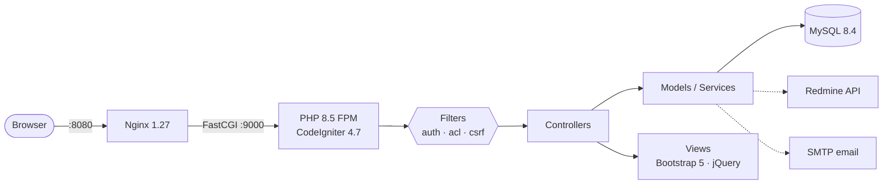
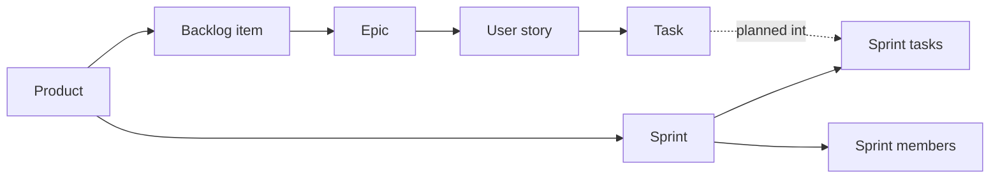

<div align="center">

<picture>
  <source media="(prefers-color-scheme: dark)" srcset="public/assets/images/logo/header_logo_dark.png">
  
</picture>

<h3>Scrum and software delivery, from backlog to retrospective.</h3>

<p>
  
  
  
  
  
</p>

<p>
  <a href="#-features">Features</a> •
  <a href="#-quick-start">Quick start</a> •
  <a href="#-installation">Installation</a> •
  <a href="#-command-reference">Commands</a> •
  <a href="#-architecture">Architecture</a> •
  <a href="#-troubleshooting">Troubleshooting</a>
</p>

</div>

---

## ✨ About

**Orvexa** is a self-hosted Scrum and delivery platform for software teams. It covers the whole loop in one place: products and backlogs, user stories and tasks, sprint planning and the sprint board, Scrum meetings, dashboards, reports, and user administration.

It is built on **CodeIgniter 4** with server-rendered views and runs as three Docker containers (PHP-FPM, Nginx, MySQL). You can have it running locally in a few minutes.

> **The name:** Orvexa combines **Or**chestrate (coordinate work), **Ve**locity (move faster), and **X** (execution, technology, collaboration).

---

## 🚀 Features

<table>
<tr>
<td width="50%" valign="top">

### 📦 Product & backlog
- Products with their own team members and roles
- Product backlog with items, epics, and document attachments
- Backlog refinement workspace
- User stories in *As a / I want / So that* form, with *Given / When / Then* acceptance criteria
- Tasks linked to user stories, with estimates and status
- Excel export of user stories

</td>
<td width="50%" valign="top">

### 🏃 Sprints
- Create sprints and plan them from product tasks
- Interactive **sprint board**
- Sprint review and retrospective records
- Sprint history and PDF sprint reports
- Planning poker estimation with configurable limits

</td>
</tr>
<tr>
<td valign="top">

### 📅 Meetings & collaboration
- Meeting calendar for daily scrums, reviews, and other ceremonies
- Holiday awareness when scheduling
- In-app notifications with unread counts
- Email reminders and queued invite emails

</td>
<td valign="top">

### 📊 Insight & personal work
- Overall and per-product **dashboards**
- Custom and meeting reports with PDF / Excel export
- **My Work**: everything assigned to you in one view
- **Efforts log** for time spent
- Global search across the workspace

</td>
</tr>
<tr>
<td colspan="2" valign="top">

### 🔐 Administration & security
User management with bulk import from a template, per-user activity history, role-based **permission management** (ACL on every module), application settings, Redmine synchronization, CSRF protection, and one-time temporary passwords that must be changed at first sign-in.

</td>
</tr>
</table>

---

## ⚡ Quick start

> **Requirements:** [Docker](https://docs.docker.com/get-docker/) with Docker Compose v2, and Git.

```bash
git clone https://github.com/Ruban-Edward/scrum_tool.git orvexa
cd orvexa
cp .env.example .env          # then set the local values shown below
docker compose up -d --build
```

Open **<http://localhost:8080>**. 🎉

The first start creates the database from `docker/mysql/init/01-scrum_tool.sql`, so give MySQL about 30 seconds to report healthy.

---

## 🛠️ Installation

### 1. Clone the repository

```bash
git clone https://github.com/Ruban-Edward/scrum_tool.git orvexa
cd orvexa
```

PHP dependencies are committed in `vendor/`, so you don't need to run `composer install`.

### 2. Create your environment file

```bash
cp .env.example .env
```

`.env.example` ships with **production** defaults (HTTPS only, secure cookies). For local development over plain HTTP, change these keys in `.env`:

```ini
CI_ENVIRONMENT = development

app.baseURL = 'http://localhost:8080/'
app.forceGlobalSecureRequests = false
cookie.secure = false

# The app and the MySQL container must use the same credentials
database.default.username = orvexa
database.default.password = orvexa

MYSQL_ROOT_PASSWORD=root
MYSQL_DATABASE=orvexa
MYSQL_USER=orvexa
MYSQL_PASSWORD=orvexa
```

> [!TIP]
> To send email (reminders, invites), fill in the `email.*` SMTP settings. Everything else works without them.

### 3. Start the stack

```bash
docker compose up -d --build
docker compose ps             # wait until orvexa_mysql shows "healthy"
```

### 4. Generate an encryption key

```bash
docker compose exec -T app php spark key:generate --show
```

Copy the printed value into `.env` as `encryption.key = ...`, then run `docker compose restart app`.

### 5. Sign in

Users sign in with their **username**. To give a user a one-time password:

```bash
docker compose exec -T app php spark orvexa:set-password <username>
```

The command prints a temporary password. It works once: Orvexa asks the user to choose a new password right after signing in.

### 🌐 Services

| Service | Container | Address | Purpose |
|---|---|---|---|
| **Web app** | `orvexa_nginx` | <http://localhost:8080> | Nginx serving the app |
| **PHP-FPM** | `orvexa_app` | `app:9000` (internal) | Runs CodeIgniter |
| **MySQL 8.4** | `orvexa_mysql` | `mysql:3306` (internal) | Database (data kept in the `orvexa_mysql_data` volume) |

---

## 📖 Command reference

<details open>
<summary><b>🐳 Docker lifecycle</b></summary>

```bash
docker compose up -d --build     # build images and start everything
docker compose ps                # container status and health
docker compose stop              # stop containers, keep them
docker compose start             # start stopped containers
docker compose restart app       # restart the PHP container (after .env changes)
docker compose down              # remove containers, KEEP the database volume
docker compose down -v           # remove containers AND delete the database ⚠️
```

</details>

<details>
<summary><b>📜 Logs and shell access</b></summary>

```bash
docker compose logs -f           # follow all logs
docker compose logs -f app       # follow PHP logs
docker compose logs -f nginx     # follow Nginx access/error logs
docker compose exec app sh       # shell inside the PHP container
docker compose exec mysql mysql -uorvexa -p orvexa   # MySQL console
```

Application logs are written to `writable/logs/`.

</details>

<details>
<summary><b>⚙️ CodeIgniter (spark)</b></summary>

```bash
docker compose exec -T app php spark list                  # all available commands
docker compose exec -T app php spark routes                # all registered routes
docker compose exec -T app php spark migrate               # run database migrations
docker compose exec -T app php spark cache:clear           # clear the app cache
docker compose exec -T app php spark key:generate --show   # generate an encryption key
```

</details>

<details>
<summary><b>🧩 Orvexa commands</b></summary>

| Command | What it does |
|---|---|
| `php spark orvexa:set-password <username>` | Sets a one-time temporary password for a user |
| `php spark invites:send` | Sends queued user invite emails (needs SMTP) |
| `php spark tasks:process_email_jobs` | Processes pending background email jobs |
| `php spark tasks:sync` | Sends reminder emails |
| `php spark tasks:run` | Runs the scheduler (reminder emails every 15 minutes) |
| `php spark websocket:start` | Starts the Ratchet WebSocket server on port `8083` inside the container |

Run each one through Docker, for example:

```bash
docker compose exec -T app php spark invites:send
```

To run scheduled jobs automatically, add a cron entry on the host:

```cron
* * * * * cd /path/to/orvexa && docker compose exec -T app php spark tasks:run >> /dev/null 2>&1
```

</details>

<details>
<summary><b>🧪 Tests</b></summary>

```bash
docker compose exec -T app ./vendor/bin/phpunit
docker compose exec -T app ./vendor/bin/phpunit tests/unit   # one suite
```

</details>

<details>
<summary><b>💾 Database backup and restore</b></summary>

```bash
# Backup
docker compose exec -T mysql sh -c 'MYSQL_PWD="$MYSQL_ROOT_PASSWORD" mysqldump -uroot orvexa' > orvexa-backup.sql

# Restore
docker compose exec -T mysql sh -c 'MYSQL_PWD="$MYSQL_ROOT_PASSWORD" mysql -uroot orvexa' < orvexa-backup.sql
```

</details>

---

## 🏗️ Architecture

Orvexa follows CodeIgniter's MVC pattern. Every request passes through route filters before it reaches a controller.



### Domain model



### Tech stack

| Layer | Technology |
|---|---|
| **Backend** | PHP 8.5 (FPM), CodeIgniter 4.7, CodeIgniter Tasks |
| **Database** | MySQL 8.4 LTS |
| **Web server** | Nginx 1.27 (Alpine) |
| **Frontend** | Server-rendered views, Bootstrap 5 (Mazer), jQuery, SweetAlert2, Parsley, flatpickr |
| **Exports** | Dompdf (PDF), PhpSpreadsheet (Excel) |
| **Integrations** | Redmine API, SMTP, Ratchet WebSockets |
| **Testing** | PHPUnit 11 |

### Project structure

```text
orvexa/
├── app/
│   ├── Commands/       # spark commands (set-password, invites, jobs, websocket)
│   ├── Config/         # Routes.php, Filters.php, PageAssets.php, Tasks.php …
│   ├── Controllers/    # one controller per module
│   ├── Filters/        # auth, acl, loginpage
│   ├── Models/         # database access
│   ├── Views/          # server-rendered pages and layout
│   └── Websockets/     # WebSocket server
├── docker/
│   ├── mysql/init/     # bootstrap schema and seed data
│   └── nginx/          # Nginx site config
├── docs/               # detailed project documentation
├── public/             # web root: index.php, CSS, JS, images
├── tests/              # PHPUnit tests
├── writable/           # logs, cache, sessions, uploads
├── Dockerfile
└── docker-compose.yml
```

> Page assets load by convention: a view named `<view>` picks up `public/assets/css/<view>.css` and `public/assets/js/<view>.js`. Design tokens live in the `--ox-*` variables of `public/assets/css/orvexa-ui.css`.

---

## 🔒 Production notes

- Keep `CI_ENVIRONMENT = production`, `app.forceGlobalSecureRequests = true`, and `cookie.secure = true`, and serve the app over **HTTPS**.
- Use long random values for every `MYSQL_*` password, and set `encryption.key`.
- Connect the app with a **least-privilege** database account (`SELECT, INSERT, UPDATE, DELETE` on `orvexa.*`), not root.
- Never commit `.env`. It is already in `.gitignore`.
- Don't publish the MySQL port to the internet.
- Make sure `writable/` is writable by `www-data`. The Dockerfile sets this up.

For deeper detail on modules, the database schema, and operations, see **[docs/ORVEXA_PROJECT_DOCUMENTATION.md](docs/ORVEXA_PROJECT_DOCUMENTATION.md)**.

---

## 🩺 Troubleshooting

<details>
<summary><b>The page redirects to <code>https://</code> or I can't stay logged in locally</b></summary>

Your `.env` still has the production defaults. Set `app.forceGlobalSecureRequests = false` and `cookie.secure = false`, then run `docker compose restart app`.

</details>

<details>
<summary><b>"Unable to connect to the database"</b></summary>

- Check that `orvexa_mysql` is **healthy**: `docker compose ps`.
- `database.default.username/password` must match `MYSQL_USER/MYSQL_PASSWORD`.
- MySQL only creates the user and imports the schema on the **first** start. If you changed the credentials afterwards, recreate the volume: `docker compose down -v && docker compose up -d` (⚠️ this deletes all data).

</details>

<details>
<summary><b>Port 8080 is already in use</b></summary>

Change the Nginx port mapping in `docker-compose.yml` (for example `"8090:80"`) and update `app.baseURL` in `.env` to match.

</details>

<details>
<summary><b>Permission denied writing to <code>writable/</code></b></summary>

```bash
docker compose exec -u root app chown -R www-data:www-data /var/www/html/writable
```

</details>

---

## 📄 License

Released under the [MIT License](LICENSE). © 2024 Ruban Edward.

<div align="center">
<br>

<br>
<sub><b>Orvexa</b> · Orchestrate Work. Accelerate Execution.</sub>
</div>
